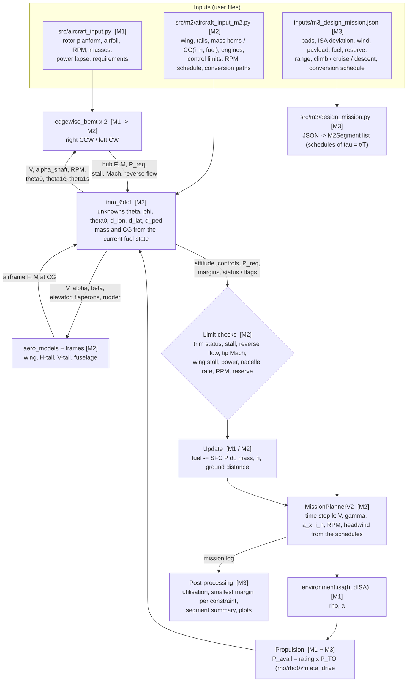
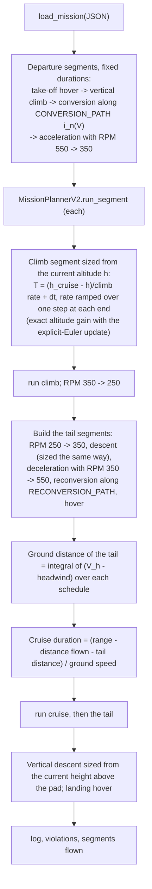

# Tiltrotor Milestone 3 — Integrated Workflow and Logic Flow (report Section 2)

Milestone 3 adds no new aerodynamic or numerical model. The final aircraft is the Milestone 2 configuration,
frozen (`src/m2/aircraft_input_m2.py`, rotor `refined`, 2 × GE CT7-8A); the Milestone 1 and 2 modules are used
together through a thin layer in `src/m3/` and `scripts/m3/`. The only change to an existing module is a
backward-compatible addition to `src/m2/mission_v2.py` (per-segment engine rating, extra log fields); with the
default `power_rating = 1.0` every Milestone 2 result is unchanged (M2 regression tests pass).

| Layer | Module | Origin |
|---|---|---|
| Atmosphere | `src/environment.py` (`isa`) | M1 |
| Airfoil, blade geometry | `src/airfoil.py`, `src/rotor.py` | M1 |
| Rotor | `src/bemt.py` (axial) → `src/m2/edgewise_bemt.py` (azimuth-resolved) | M1 → M2 |
| Airframe aerodynamics, frames | `src/m2/aero_models.py`, `src/m2/frames.py` | M2 |
| Trim | `src/m2/trim_6dof.py` | M2 |
| Propulsion / power | `PowerAvailableModel`, `FuelModel` (`src/mission.py`); engines and MCP rating (`aircraft_input_m2.py`); rating per segment (`mission_v2.py`) | M1 + M2 + M3 |
| Mission | `src/m2/mission_v2.py` (`MissionPlannerV2`) + `src/m3/design_mission.py` | M2 + M3 |
| Design data | `src/aircraft_input.py` (requirements), `src/m2/aircraft_input_m2.py` (aircraft), `src/m3/final_design.py` (changes, assumptions, reference aircraft), `inputs/m3_design_mission.json` (mission) | M1 + M2 + M3 |

The same picture as a figure: `outputs/m3/m3_2p2_workflow.png` (`scripts/m3/plot_workflow.py`).

---

## 2.1 New or modified assumptions

| Area | Milestone 3 assumption |
|---|---|
| Propulsion | Power available = max-continuous rating (`MCP_FRACTION` = 86 % of take-off) in airplane-mode climb, cruise and descent; take-off rating only in hover, vertical flight and conversion (< 5 min). Lapse, drivetrain efficiency and constant SFC as in M2. |
| Mission | One continuous mission from vertical take-off to vertical landing. Climb, cruise and vertical-descent durations sized at run time so the mission reaches the cruise altitude, flies the specified ground range and lands on the pad. |
| Mission | Constant ISA deviation over the route; constant headwind aloft, calm at the pads; payload fixed. |
| Mission | Time step 5 s in helicopter mode, 2 s in conversion, 30 s in climb / descent, 120 s in cruise; explicit Euler state update as in M2. |
| Feasibility | Limits unchanged from M2; each is also expressed as a utilisation (fraction of the allowable used). |
| Interaction | Unchanged: no rotor-wake / wing interference, no hover download, no rotor–rotor interference (side-by-side rotors do not overlap). |

The full table is generated to `outputs/m3/m3_2p1_assumptions.md` from `src/m3/final_design.py`.

---

## 2.2 Integrated analysis workflow



`scripts/m3/performance_summary.py` calls the same `trim_6dof` directly (no mission) for the hover and cruise
operating points, the hover envelope and the maximum level speed; the conversion corridor of Milestone 2
(`outputs/m2/rotor_refined/corridor_grid.npz`) is reused as computed.

---

## 2.3 Design-mission builder (`design_mission.fly`)



Engine rating per segment: take-off rating for hover / vertical / conversion types, `MCP_FRACTION` for
airplane, climb, cruise and descent types (`engine_ratings` in the JSON).

---

## 2.4 Constraint utilisation and margins (`design_mission.utilisation`, `margin_table`)

Every limit already checked by Mission Planner v2 is expressed as the fraction of its allowable value used at each
logged step (≤ 1 feasible); the largest value at any instant is the active constraint, and `margin_table` returns,
per constraint, the peak, the margin (1 − peak), the segment, time, airspeed, altitude, nacelle angle and RPM.

| Constraint | Utilisation |
|---|---|
| Power | P_req / (0.95 P_avail) |
| Rotor stall | stalled loaded area / 5 % |
| Advancing-tip Mach | M_tip / 0.85 |
| Reverse flow | reverse-flow area / 3 % |
| Wing stall | \|alpha_w\| / alpha_stall (V > 10 m/s) |
| Collective | theta0 / 65 deg (or / −10 deg when negative) |
| Pilot controls | max(\|d_lon\|, \|d_lat\|, \|d_ped\|) |
| Nacelle rate | \|di_n/dt\| / 8 deg/s |
| Fuel | fuel burned / (initial fuel − reserve) |

The conversion and reconversion segments are also evaluated on their own (`make_m3_tables.restrictive`) to give
the tightest constraint during transition.

---

## 2.5 Code organisation and reproducibility

```
inputs/m3_design_mission.json      design mission (user input)
src/m3/design_mission.py           JSON -> segments, run-time sizing, utilisation / margins / segment summary
src/m3/final_design.py             requirements, changes after M2, new assumptions, reference-aircraft data
src/m2/mission_v2.py               + power_rating per segment, + log fields (sticks, collective / power margin)
scripts/m3/_common.py              paths, plot style, save_figure -> outputs/m3/ + FIGURES.md captions
scripts/m3/plot_final_schematic.py final schematic (reuses the M2 drawing) + component locations
scripts/m3/plot_workflow.py        workflow figure
scripts/m3/performance_summary.py  operating points, fuel per km, hover envelope, max speed, limits, corridor summary
scripts/m3/run_design_mission.py   flies the mission; definition, time histories, utilisation, margins, segment summary
scripts/m3/make_m3_tables.py       design table, changes, requirement status, assumptions, transition constraint, comparison
run_all_m3.py                      runs the five scripts in order (≈ 20 min; --skip-mission re-plots from the log)
```

Geometry, operating conditions, controls and the mission are inputs (`aircraft_input.py`,
`aircraft_input_m2.py`, the mission JSON); any other mission is flown with
`python scripts/m3/run_design_mission.py --mission <file>`.
